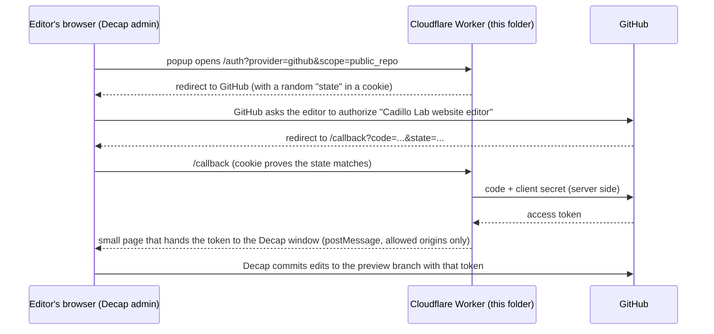

# GitHub login proxy for the content editor (`cms-oauth/`)

The content editor at <https://cadillo-lab.github.io/admin/> (Decap CMS) lets
lab members sign in with their GitHub account. GitHub's sign-in handshake needs one
secret that must never sit in a browser, so a tiny Cloudflare Worker, the code in this
folder, keeps that secret. The Worker does nothing else and stores nothing.

> **中文速览** 这个文件夹是后台"用 GitHub 登录"所需的代理，部署到 Cloudflare Workers（免费额度足够）。
> 需要手动完成五步：① 部署 Worker，拿到它的网址；② 在 GitHub 注册一个 OAuth App，回调地址填
> "Worker 网址 + /callback"；③ 把 Client ID 和 Client Secret 写进 Worker 的加密环境变量；
> ④ 核对 `public/admin/config.yml` 里预填的 `base_url`（`https://cms-auth.cadillo-lab.workers.dev`）与部署打印出的网址一致；⑤ 打开后台用 GitHub 登录验证。
> 下面每一步都有具体的字段和命令。密钥只存在 Cloudflare 里，不进仓库。

## How it works



| File | Purpose |
| --- | --- |
| `worker.js` | The Worker: `/auth` starts the login, `/callback` finishes it. Commented. |
| `wrangler.toml` | Worker name and the two non-secret settings (`ALLOWED_ORIGINS`, `ALLOW_LOCALHOST`). |
| `worker.test.js` | Offline tests, no network or secrets needed: `node --test` in this folder. |
| `package.json` | Shortcuts: `npm test`, `npm run deploy`, `npm run secrets`. No dependencies. |

## Before you start

- A Cloudflare account. The free plan is enough: <https://dash.cloudflare.com/sign-up>
- A GitHub account that may create OAuth Apps for the **Cadillo-Lab** organization
  (an organization owner). A personal account also works, but then the login app is
  owned by that person; see `docs/CONTENT-MAINTENANCE.md` about handover.
- Node.js 20 or newer on your computer (the website already needs it).

## Step 1 - Deploy the Worker and note its URL

```bash
cd cms-oauth
npx wrangler@4 login
```

```bash
npx wrangler@4 deploy
```

`login` opens the browser; approve the Cloudflare login. The account's `workers.dev`
subdomain is `cadillo-lab`, so the output of `deploy` ends with the Worker's address:

```
https://cms-auth.cadillo-lab.workers.dev
```

If it prints a different address (for example because the Worker was deployed to another
Cloudflare account), use that one everywhere below instead. That address is **the Worker
URL** in the steps below. Open it in a browser: it shows a
one-line text saying it is the login proxy.

## Step 2 - Register the GitHub OAuth App

Open <https://github.com/organizations/Cadillo-Lab/settings/applications/new>
(Organization -> Settings -> Developer settings -> OAuth Apps -> New OAuth App).
If you are not an organization owner, <https://github.com/settings/applications/new>
creates it under your own account instead.

| Field | Value |
| --- | --- |
| Application name | `Cadillo Lab website editor` |
| Homepage URL | `https://cadillo-lab.github.io` |
| Application description | `Sign-in for the content editor of the lab website` (optional) |
| Authorization callback URL | the Worker URL + `/callback`, i.e. `https://cms-auth.cadillo-lab.workers.dev/callback` |
| Enable Device Flow | leave unchecked |

Click **Register application**. The next page shows the **Client ID**. Click
**Generate a new client secret** and copy the secret right away; GitHub shows it only once.

## Step 3 - Give the two values to the Worker as secrets

```bash
npx wrangler@4 secret put GITHUB_CLIENT_ID
```

```bash
npx wrangler@4 secret put GITHUB_CLIENT_SECRET
```

Each command waits for you to paste the value and press Enter. (`npm run secrets` runs
both.) The same can be done in the Cloudflare dashboard: Workers & Pages ->
cms-auth -> Settings -> Variables and Secrets -> Add, type **Secret**.
No new deploy is needed; secrets stay in place across later deploys.
Never paste these values into any file in the repository.

## Step 4 - Check that the editor points at the Worker

`public/admin/config.yml` already contains the expected address:

```yaml
  base_url: https://cms-auth.cadillo-lab.workers.dev
  auth_endpoint: auth
```

`base_url` must be the Worker URL exactly as Step 1 printed it: `https://`, the host,
nothing after it. If Step 1 printed something else, change this line, then commit and
push to `test_edit_this_firstly`; the "Deploy to GitHub Pages" workflow publishes the
updated editor to `/admin/` within a few minutes. `auth_endpoint` stays `auth`.

## Step 5 - Verify the login

1. Open <https://cadillo-lab.github.io/admin/> and click **Login with GitHub**.
   A popup shows GitHub's authorization page for "Cadillo Lab website editor"; click
   **Authorize**. The popup closes and the collections (Team, Join Us, Publications) appear.
2. Make a harmless test edit, for example change the alternative text of one outreach
   photo under Join Us -> Banner and outreach photos, and click **Publish -> Publish now**.
3. On GitHub, the branch `test_edit_this_firstly` now has a commit like
   `content: update joinus "joinus" (<your login>)`, and the Actions tab shows a new
   "Deploy to GitHub Pages" run. When it is green, <https://cadillo-lab.github.io/preview/>
   shows the change. Change it back the same way if you like.

Who can log in: GitHub refuses nobody, but Decap only lets in accounts with **write**
access to `Cadillo-Lab/cadillo-lab.github.io`. Everyone else sees "Your GitHub user
account does not have access to this repo". Add editors as collaborators with the Write
role (or as organization members with write permission on the repository).

## Troubleshooting

| What you see | Cause and fix |
| --- | --- |
| The popup opens and closes again, the editor stays on the login page | `base_url` in `config.yml` is not exactly the Worker's address (wrong host, `http`, or a path after the host). Fix it and push. Also check that the browser is not blocking popups for cadillo-lab.github.io. |
| GitHub shows "The redirect_uri MUST match the registered callback URL" | The callback URL from Step 2 is not the Worker URL + `/callback`. Edit the OAuth App. |
| The popup shows "Server not configured: ... not set" | Step 3 was skipped or a secret name was mistyped. |
| The popup shows "This login proxy only serves the Cadillo Lab website" | The editor was opened from a host that is not in `ALLOWED_ORIGINS` (wrangler.toml). |
| Login works, but "does not have access to this repo" | The GitHub account has no write access to the repository. |
| Login works, but saving fails with 403 or 404 | Same cause as above, or the organization restricts third-party OAuth apps: Organization -> Settings -> Third-party access -> approve "Cadillo Lab website editor". An app created under the organization itself does not need this. |

Request logs: Cloudflare dashboard -> Workers & Pages -> cms-auth -> Logs.

## Local testing (optional)

- `node --test` in this folder runs the offline tests of `worker.js`.
- The deployed Worker also accepts the editor served from `http://localhost:<port>` or
  `http://127.0.0.1:<port>` while `ALLOW_LOCALHOST` is `"true"` in `wrangler.toml`, so a
  local `npm run build` served by any static server can log in for real. Set it to
  `"false"` and redeploy once nobody needs that.
- `npx wrangler@4 dev` runs the Worker itself on <http://localhost:8787>; it reads secrets
  from a file named `.dev.vars` in this folder (two lines, `GITHUB_CLIENT_ID=...` and
  `GITHUB_CLIENT_SECRET=...`). That file is ignored by git. A local Worker needs its own
  OAuth App whose callback URL is `http://localhost:8787/callback`; this is rarely worth it.

## Changing or handing over

- **New client secret:** GitHub OAuth App -> Generate a new client secret ->
  `npx wrangler@4 secret put GITHUB_CLIENT_SECRET` -> delete the old secret on GitHub.
- **Handover:** the OAuth App can be transferred (OAuth App -> Transfer ownership) to the
  organization or to a person; the Worker lives in whoever's Cloudflare account ran
  `deploy`. A successor can add themselves as a member of that Cloudflare account, or
  deploy this folder from their own account and update both the callback URL (Step 2)
  and `base_url` (Step 4).
- **Switch everything off:** delete the Worker in Cloudflare, or delete the OAuth App on
  GitHub. Either one stops all editor logins immediately; the website itself is not affected.

## Security notes

- The client secret exists only in Cloudflare's encrypted secret storage and is used in one
  server-side request to GitHub. It is never written to a file, a log, or a page.
- Every login carries a random `state` in an HttpOnly cookie that the callback must match.
- The access token travels to the editor window only through `postMessage`, never in a
  URL, and only to origins listed in `ALLOWED_ORIGINS` (plus localhost while allowed).
- The editor asks GitHub for the `public_repo` permission only (`auth_scope` in
  `config.yml`), which is enough for this public repository.
- `worker.js` sets `Cache-Control: no-store`, `Referrer-Policy: no-referrer` and a
  Content-Security-Policy with a per-response nonce on the pages it returns.
