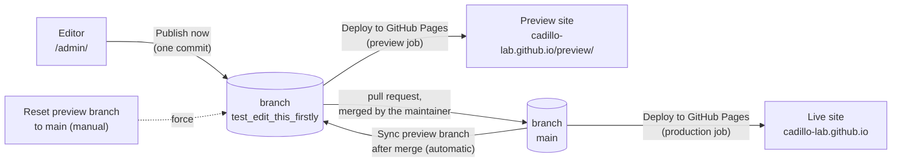

# Cadillo Lab website: content maintenance guide

内容维护指南。English first; each section ends with a short **中文要点** block.

This guide is for two roles:

- **Editors**: lab members who change the Team, Join Us and Publications pages in the
  browser. No coding, no software to install.
- **The maintainer**: the one person who publishes to the live site, manages accounts,
  and calls a developer when a page outside the editor must change.

| What | Where |
| --- | --- |
| Live site | <https://cadillo-lab.github.io/> |
| Preview site (edits appear here first) | <https://cadillo-lab.github.io/preview/> |
| Content editor | <https://cadillo-lab.github.io/admin/> |
| Source code and content | <https://github.com/Cadillo-Lab/cadillo-lab.github.io> |
| Build and publish runs ("Actions") | <https://github.com/Cadillo-Lab/cadillo-lab.github.io/actions> |
| Open a pull request (preview -> live) | <https://github.com/Cadillo-Lab/cadillo-lab.github.io/compare/main...test_edit_this_firstly?expand=1> |
| Login proxy (maintainer only) | `cms-oauth/README.md`, Worker `cms-auth` at <https://cms-auth.cadillo-lab.workers.dev> |

## Start here

**Editors** (you change text and pictures): read this section, then sections 3 to 7.
Section 10 helps when something does not work. Sections 1, 2.2, 2.3, 8 and 9 are for the
maintainer; you can skip them.

**Maintainer** (you put changes on the live site and manage accounts): read everything.

### First time only: get access (about 10 minutes)

1. Get a free GitHub account, if you do not have one.
   1. Go to <https://github.com/signup>.
   2. Any e-mail works. Choose a user name you are happy to show the lab, for example
      `maria-lopez`.
   3. Confirm the e-mail that GitHub sends you.
2. Send your GitHub user name to the maintainer.
3. The maintainer adds you to the website repository (section 8.1). GitHub then e-mails
   you an invitation.
   1. Open the e-mail and click **View invitation**.
   2. Click **Accept invitation**.
4. Done. From now on you log in as in the next list.

### Every time: change something and publish (about 5 minutes)

1. Log in.
   1. Open <https://cadillo-lab.github.io/admin/>.
   2. Click **Login with GitHub**.
   3. A small window shows GitHub. The first time it asks you to authorize
      "Cadillo Lab website editor": click **Authorize**. The window closes by itself and
      the editor appears.
   4. If no small window appears, the browser blocked it: look for a "pop-up blocked"
      icon at the right end of the address bar, allow pop-ups for this site, and click
      **Login with GitHub** again.
2. Open the page you want to change.
   1. In the left column click **Team**, **Join Us** or **Publications**.
   2. Click the entry shown in the middle (for example **Team page**). The whole page
      opens as a form.
3. Make the change.
   1. Scroll to the list you need, for example **Graduate researchers**.
   2. To change an existing person or paper: click the small arrow at the left of its
      row to open it, then edit the text in the boxes. To change a photo, click
      **Choose different image**.
   3. To add one: click the **Add …** button at the top right of the list. Sections 5
      and 6 go through adding a person and a paper field by field.
   4. To remove one: click the **x** at the top right of its row.
   5. To change the order: drag the **=** handle at the top of a row.
4. Publish.
   1. Click **Publish** at the top, then **Publish now**.
   2. The label at the top left changes from "UNSAVED CHANGES" to "CHANGES SAVED".
      Until that happens nothing is stored; closing the tab loses the change.
5. Check the preview site.
   1. Wait 2 to 4 minutes.
   2. Open <https://cadillo-lab.github.io/preview/> and go to the page you changed. If
      it still looks old, reload with Ctrl+F5 (Windows) or Cmd+Shift+R (Mac).
   3. Not right? Go back to the editor, fix it, publish again. Publish as often as you
      like: the live site is not affected.
6. Tell the maintainer that the preview is ready to go live. The maintainer follows
   section 2.2, and the live site updates a few minutes after that.

**中文要点**

- 第一次：在 github.com/signup 注册账号 → 把用户名发给维护者 → 打开邀请邮件点 Accept invitation。
- 每次：打开 /admin/ 点 Login with GitHub（弹窗被拦截就在地址栏右侧允许弹窗）→ 左栏选页面、点中间的条目 → 点行首箭头展开修改，或 Add 新增、x 删除、拖 = 排序 → **Publish → Publish now**，左上角变成 CHANGES SAVED 才算保存 → 2–4 分钟后看 /preview/（不更新就 Ctrl+F5）→ 通知维护者上线。
- 预览站可以反复改、反复发布；线上站只有维护者合并后才会变。

## 1. How the site is published



- The website is a React application. Its text and images for the Team, Join Us and
  Publications pages live in plain data files under `src/content/` and `public/images/`.
  The editor changes only those files.
- Every **Publish now** in the editor becomes one commit on the branch
  `test_edit_this_firstly`. A GitHub Actions workflow called **Deploy to GitHub Pages**
  then builds the site and publishes it under <https://cadillo-lab.github.io/preview/>.
  This usually takes 2 to 4 minutes. Nothing on the live site changes.
- The live site is built from the branch `main`. Content reaches `main` only when the
  maintainer merges a pull request from `test_edit_this_firstly`. The same workflow then
  publishes the live site, and a second workflow, **Sync preview branch after merge**,
  moves the editing branch forward so that preview and live are identical again.
- Both sites are files on the branch `gh-pages`. Nobody edits that branch by hand.

**中文要点**

- 编辑器里的每次 Publish 都是对分支 `test_edit_this_firstly` 的一次提交，几分钟后出现在预览站 `/preview/`，线上站不受影响。
- 线上站来自分支 `main`。只有维护者把预览分支的 pull request 合并进 `main`，内容才上线；合并后预览分支会自动对齐。
- `gh-pages` 分支是构建产物，不要手工改。

## 2. The three actions

### 2.1 Publish (editors)

In the editor, after changing something, click **Publish** and then **Publish now**. The
header changes from "Unsaved changes" to "Changes saved".

 Wait a few minutes and check the
preview site. That is all an editor does; nothing goes live by itself.

### 2.2 Merge the pull request (maintainer): preview becomes live

1. Open <https://github.com/Cadillo-Lab/cadillo-lab.github.io/compare/main...test_edit_this_firstly?expand=1>.
   GitHub shows every change since the last publication, file by file (JSON data and
   images). If it says "There isn't anything to compare", there is nothing new.
2. Click **Create pull request**, give it a title such as "Website update November 2026",
   and create it. The check **Build check (pull request)** runs automatically; wait until
   it is green. The page may also say "Some checks were not successful" because of a red
   check named **Vercel**: that is an old, unrelated integration and can be ignored. Only
   **Build check** matters.
3. Look at the preview site one last time, then click **Merge pull request** and
   **Confirm merge**. Any merge method works (the plain merge commit is the default).
4. Within a few minutes the Actions tab shows a green **Deploy to GitHub Pages** run for
   `main`; the live site now has the content. **Sync preview branch after merge** runs
   right after it and triggers one more preview build, so the preview matches the live
   site again.
5. Check <https://cadillo-lab.github.io/>. If a page looks wrong, revert the merge on
   GitHub (the pull request page has a **Revert** button) and the previous content comes
   back the same way.

Editors can keep working while a pull request is open; their new publishes join the same
pull request until it is merged.

### 2.3 Reset the preview (maintainer): throw away unpublished edits

If the preview branch contains edits that should never go live (a mistake, an abandoned
draft), reset it:

1. Open the Actions tab, choose **Reset preview branch to main** in the left column, click
   **Run workflow**, keep "main" selected, click the green **Run workflow** button.
2. The workflow makes `test_edit_this_firstly` identical to `main` and rebuilds the
   preview site. Everything that was only on the preview branch is gone, including
   images uploaded there. The live site is untouched.

Tell the editors before doing this, because an open pull request from the preview branch
will show no changes afterwards.

**中文要点**

- 编辑者：改完点 **Publish → Publish now**，几分钟后看预览站。
- 维护者上线：打开上面的"Open a pull request"链接 → Create pull request → 等 Build check 变绿 → Merge pull request → 几分钟后看线上站。出问题可在 PR 页面点 Revert 回退。
- 维护者丢弃预览：Actions → **Reset preview branch to main** → Run workflow。预览分支上未合并的改动全部丢失，线上不受影响；先通知编辑者。

## 3. Logging in to the editor

1. Open <https://cadillo-lab.github.io/admin/> and click **Login with GitHub**.
2. A popup shows GitHub. The first time, GitHub asks you to authorize "Cadillo Lab
   website editor"; click **Authorize**. The popup closes and the three collections
   (Team, Join Us, Publications) appear.
3. If the popup says "Your GitHub user account does not have access to this repo", your
   GitHub account is not yet a collaborator. Ask the maintainer (section 8.1).

You need a free GitHub account. The editor never sees your GitHub password; GitHub only
hands it a limited access token for public repositories.

**中文要点**

- 用 GitHub 账号登录，第一次需要点 Authorize。提示没有权限时，请维护者把你加为仓库协作者（Write 权限）。

## 4. Editor basics


- **Collections** in the left column are the three editable pages. Each one opens a single
  entry ("Team page", "Publications page", ...) that holds the whole page.
- Most content is a **list**: a numbered row per person, position, photo or paper. Rows
  are collapsed to one line; click the small arrow at the left of a row to open it.
- **Add** buttons sit at the top right of every list ("Add graduate researcher",
  "Add publication", ...). New rows appear at the bottom of the list.
- **Reorder** by dragging the handle (the "=" symbol) at the top of a row. The order in the
  editor is the order on the page, except for the lists marked "grouped by year", which
  the site sorts by itself.
- **Delete** a row with the "x" at its top right.
- **Images**: click **Choose an image** (or **Choose different image**). A window shows the
  images already used by that part of the site; click **Upload** to add a new one from
  your computer, then **Choose selected**. Give files short names without spaces before
  uploading, for example `maria-lopez.jpg` or `2026-nature-microbiology.png`.
  
- The grey text under a field is a hint about how the site uses it.
- Leaving the page with unsaved changes shows a browser warning; nothing is stored until
  you click **Publish now**.
- There is no live preview inside the editor on purpose; the preview site shows the real
  result a few minutes after publishing.

Image sizes that fit the current design:

| Image | Shown as | Upload |
| --- | --- | --- |
| Team member photo | circle, about 240 px | square photo, 500 to 1000 px on each side, JPG or PNG, under 500 KB |
| Faculty photo | 280 x 280 px | square, as above |
| Publication thumbnail | about a third of the page width, enlarges on hover | portrait, about 850 x 1100 px (the existing ones), PNG or JPG, under 500 KB |
| Join Us banner | full width, about 3:1 | landscape, about 2900 x 1000 px |
| Outreach carousel photo | full width, 500 px tall, cropped to fit | landscape, about 1500 x 1000 px |

Large photos work, but they slow the page down for visitors; several current photos are
over 1 MB and could be re-saved smaller at any time.

**中文要点**

- 左栏三个集合对应三个页面；内容多为列表，点行首箭头展开，右上角 Add 新增，拖动行顶的 "=" 调整顺序，右上角 x 删除。
- 图片点 Choose an image → Upload 上传，文件名用短的英文和连字符，不带空格；照片尽量正方形、小于 500 KB。
- 只有点了 Publish now 才会保存；编辑器里没有实时预览，几分钟后看预览站。

## 5. Step by step: add a team member


1. Collections -> **Team** -> **Team page**.
2. Scroll to the list for the right group: **Graduate researchers**, **Postdoctoral
   researchers** or **Undergraduate researchers**.
3. Click **Add graduate researcher** (or the matching button). A new row opens at the
   bottom of the list.
4. Fill in:
   - **Name**: as it should appear under the photo.
   - **Role / program**: the small grey line, for example `ELS Ph.D. student`.
   - **Photo**: Choose an image -> Upload -> pick the file -> Choose selected.
   - **Details shown on hover** (graduate and postdoctoral researchers only): the text
     that appears in the grey box when a visitor hovers over the photo. An empty line
     starts a new paragraph.
   - **Bio** can stay empty; the page does not show it at the moment.
5. Drag the row to the right place in the list; the page shows people in this order.
6. **Publish -> Publish now**. Check <https://cadillo-lab.github.io/preview/team> after a
   few minutes.


**When someone leaves:** open their row, note the details, delete the row with the "x", then
add them under **Alumni** in the matching list (for example **Graduate alumni** with
**Name** and **Details** such as `Ph.D. student in Microbiology (2021-2026)`). The alumni
lists marked "grouped by year" (honors theses, high school researchers, international
scholars) sort themselves by year; the others keep the order you give them. The last row
of **Postdoctoral alumni**, with a blank name and blank details, is intentional spacing;
leave it where it is.

**中文要点**

- Team → Team page → 找到对应列表 → Add … → 填 Name、Role、Photo（上传）、悬停详情 → 拖到正确位置 → Publish now → 几分钟后看预览站 /preview/team。
- 成员离开：删除该行，在 Alumni 对应列表里新增一行（姓名 + 说明）。Postdoctoral alumni 最后一行空白是刻意的间距，请保留。

## 6. Step by step: add a paper


1. Collections -> **Publications** -> **Publications page**.
2. Under **Sections**, open the section for the year (click its row, for example `2026`).
   If the year does not exist yet, see "A new year" below.
3. Inside the section, click **Add publication**. A new row opens at the bottom of that
   section's list.
4. Fill in:
   - **Thumbnail**: the picture visitors click. Most existing ones are the first page or
     a key figure of the paper, portrait, about 850 x 1100 px.
   - **Link (URL)**: where the thumbnail leads, usually the DOI address such as
     `https://doi.org/10.1128/spectrum.00387-24` or the journal page.
   - **Title**: used as the alternative text of the thumbnail (read by screen readers
     and shown if the image fails to load). Please fill it in for new papers.
   - **Authors**, **Journal**, **Year**, **DOI**: optional records for the lab's own
     bookkeeping; the page does not display them. If **Link** is empty, the DOI is used to
     build the link.
5. Drag the row to where it should appear within the section (first row = first on the
   page), then **Publish -> Publish now**. Check
   <https://cadillo-lab.github.io/preview/publications>.

**A new year:** click **Add section** at the top of the Sections list, set **Heading** to
the year (the page shows it as "Publications from 2026"), leave **Indent level** at `0`,
then drag the new section to the top of the list so the newest year comes first. Add
papers to it as above.

**About "Indent level":** the page shows the older groups "2020 - 2021" and "2011 - 2015"
indented under the section above them, a leftover of how the page was first written.
Their Indent level values (1 and 2) keep that look exactly as it was. New sections use `0`.
Do not change the value on existing sections unless you want the layout to change.

**中文要点**

- Publications → Publications page → 展开对应年份的 section → Add publication → 上传缩略图（竖版约 850×1100）、填 Link（通常是 DOI 网址）和 Title → 拖到合适位置 → Publish now。
- 新年份：Sections 顶部 Add section → Heading 填年份 → Indent level 保持 0 → 拖到最上面。
- Indent level 只是为了保留旧年份组原有的缩进外观，已有 section 不要改动。

## 7. The other editable parts

| Where in the editor | What it changes on the site |
| --- | --- |
| Team -> Team page -> **Faculty** | The professor's name, title, contact line, photo, education lines and biography paragraphs at the top of the Team page. |
| Team -> Team page -> **Alumni** | The six collapsible alumni lists at the bottom of the Team page. |
| Join Us -> **Open positions** | The "Open Position" / "Position" drop-downs in the three sections of the Join Us page. An empty list shows "No positions available". A position has a title and a description; the description is shown as one block of text. |
| Join Us -> **Graduate program links** | The comma-separated list of program links after "Professor Cadillo is a faculty member in the following programs:". |
| Join Us -> **Banner and outreach photos** | The banner image at the top of Join Us and the rotating outreach photos at the bottom (they rotate in the order of the list). |
| Publications -> Publications page -> **Banner image** | The banner at the top of the Publications page. |

**Not editable in the editor:** the Home, Research, Collaborations and Mission Statement
pages, the navigation bar, the footer, colours and layout. Those are part of the code and
need a developer (section 9).

**中文要点**

- 教授信息、校友列表、招聘职位、项目链接、Join Us 横幅与轮播图、Publications 横幅都在编辑器里；首页、Research、Collaborations、Mission Statement、导航、页脚和样式需要开发者改代码。

## 8. For the maintainer: accounts, access and handover

### 8.1 Giving someone editing rights

Repository -> **Settings** -> **Collaborators and teams** -> **Add people** -> enter their
GitHub user name -> role **Write**. They accept the invitation by e-mail, then they can log
in to the editor. Remove people the same way when they leave the lab. Anyone with
**Write** can technically also merge pull requests and run the reset workflow; by
agreement only the maintainer does, so tell new editors to stop at **Publish now**.

### 8.2 Who owns what

| Thing | Where it lives | Who must have access |
| --- | --- | --- |
| Source code, content, images, workflows | GitHub repository `Cadillo-Lab/cadillo-lab.github.io` | The maintainer as organization owner or repository admin; editors with Write. |
| Published site (live and preview) | GitHub Pages, branch `gh-pages` | Automatic; nobody edits it. |
| Login proxy `cms-auth` | A Cloudflare account (Workers, free plan) | The maintainer; add a second member under Cloudflare -> Manage Account -> Members. |
| GitHub OAuth App "Cadillo Lab website editor" | GitHub, ideally owned by the Cadillo-Lab organization | Organization owners. |
| Editor software (Decap CMS) | Loaded from a public CDN, version pinned in `public/admin/index.html` | No account. |

Record here who holds the Cloudflare account and when the OAuth App was created:

- Cloudflare account e-mail: wliu176@asu.edu (Wanxiang Liu; Workers subdomain cadillo-lab.workers.dev)
- OAuth App created on: 2026-11-05, owned by: GitHub user Johnxiaoming (Wanxiang Liu). Note: Cadillo-Lab is a personal GitHub account, not an organization; transfer the OAuth App to it at handover.

### 8.3 Handover checklist

When the maintainer changes:

1. GitHub: make the successor an owner of the Cadillo-Lab organization (or at least an
   admin of the repository).
2. Cloudflare: invite the successor as a member of the account that hosts `cms-auth`,
   or let them redeploy the Worker from `cms-oauth/` under their own account and update
   both the OAuth App's callback URL and `base_url` in `public/admin/config.yml`
   (`cms-oauth/README.md`, steps 1 to 4).
3. GitHub OAuth App: if it is owned by a person, transfer it to the organization
   (OAuth App page -> **Transfer ownership**). Generate a new client secret and store it
   with `npx wrangler@4 secret put GITHUB_CLIENT_SECRET`; delete the old one.
4. Update the two lines in 8.2 and the maintainer's name wherever it is written.

### 8.4 If something is lost

- **Cloudflare account gone:** deploy `cms-oauth/` again under any Cloudflare account,
  create a new OAuth App, set the secrets, update `base_url`. About one hour of work; the
  website keeps running meanwhile, only editor logins stop.
- **The editor no longer loads:** the CDN file is pinned to one version with an
  integrity hash in `public/admin/index.html`; the comment there explains how to change
  the version and recompute the hash. Until fixed, content can still be changed by editing
  the JSON files on GitHub directly.
- **A workflow fails:** open the red run in the Actions tab; the failing step shows the
  error. The most common causes are a broken image path in a JSON file (fix it in the
  editor or on GitHub) and GitHub-side outages (just rerun the workflow with
  **Re-run jobs**).

### 8.5 Things to keep in mind

- Never run `npm run deploy` on a computer. It replaces the whole `gh-pages` branch with a
  local build and deletes the preview site. The `predeploy` / `deploy` scripts and the
  `gh-pages` package are still in `package.json` from the old manual process; remove them
  in a separate commit after the first successful live deployment by GitHub Actions.
- The editing branch name `test_edit_this_firstly` is written in five places:
  `.github/workflows/deploy.yml` (twice), `reset-preview.yml`, `sync-after-merge.yml` and
  `public/admin/config.yml`. Renaming the branch means changing all five.
- GitHub Pages is case-sensitive: `Photo.JPG` and `photo.jpg` are different files. The
  editor's uploader avoids problems; renaming files by hand on GitHub can cause them.
- The preview and live sites each contain a copy of every image and of the large
  background video of the home page, so the `gh-pages` branch is a few hundred megabytes.
  That is normal.

**中文要点**

- 加编辑者：仓库 Settings → Collaborators and teams → Add people → Write。合并 PR 和重置预览只留给维护者（Admin）。
- 四样东西要有人管：GitHub 组织/仓库、Cloudflare 账号（cms-auth）、GitHub OAuth App（建议归组织所有）、编辑器版本（写在 index.html 里）。
- 交接：继任者成为组织 owner → 加入 Cloudflare 账号或自行重新部署 → OAuth App 转给组织并换 secret → 更新本文 8.2。
- 绝不要再运行 `npm run deploy`；分支名写在五处；Actions 首次成功上线后，单独提交删除旧的 deploy 脚本。

## 9. For developers

Local setup:

```bash
git clone https://github.com/Cadillo-Lab/cadillo-lab.github.io.git
```

```bash
npm ci
```

```bash
npm start
```

`npm start` serves the site at <http://localhost:3000>. To use the content editor against
your local files, run `npx decap-server` in a second terminal and open
<http://localhost:3000/admin/index.html> (the development server needs the full file
name; on the published site plain `/admin/` works). "Login" then works without GitHub and
writes directly into `src/content/` and `public/images/` of your checkout.

- Build check: `CI=false npm run build` (the `CI=false` keeps ESLint warnings from failing
  the build, as in the workflows).
- Content files: `src/content/*.json` (one file per editable page or section, see
  `public/admin/config.yml` for the fields). Components read them with `import`.
- Images managed by the editor: `public/images/{team,joinus,publications}`; components
  prefix them with `process.env.PUBLIC_URL` so they work at `/` and at `/preview/`.
  Images bundled by webpack (Home, Research, Collaborations) stay in `src/assets/`.
- Routing: `BrowserRouter` gets `basename={process.env.PUBLIC_URL}`, and `public/404.html`
  keeps the `preview` path segment, which is what makes deep links work under `/preview/`.
- Workflows: `deploy.yml` (production, preview, pull-request check), `sync-after-merge.yml`,
  `reset-preview.yml`; all comments are in the files. Node 22, `npm ci`.
- Code changes follow the same path as content: push to `test_edit_this_firstly`, look at
  the preview, open a pull request, merge.

### 9.1 Switching from Decap CMS to Sveltia CMS

[Sveltia CMS](https://github.com/sveltia/sveltia-cms) is a drop-in replacement for Decap
with a more modern interface, a built-in "work with a local folder" mode (no
`decap-server`) and active development. It reads the same `config.yml` and uses the same
GitHub login handshake, so the `cms-auth` Worker stays. Untested here; do it on the preview
site first:

1. In `public/admin/index.html`, replace the Decap `<script>` tag with
   `<script type="module" src="https://unpkg.com/@sveltia/cms@<version>/dist/sveltia-cms.js"></script>`,
   pinned to a specific version (0.259.0 was current in November 2026; Sveltia has not
   reached 1.0, so read its release notes).
2. Publish, open <https://cadillo-lab.github.io/admin/>, log in, open each
   collection and make a test publish. Check the commit it creates and the preview site.
3. Compare `public/admin/config.yml` with Sveltia's documented options; `editor.preview`,
   `local_backend` and `commit_messages` may behave differently or be ignored.
4. If the GitHub login fails with Sveltia, deploy Sveltia's own `sveltia-cms-auth` Worker
   with the same two secrets and point `base_url` at it.
5. To go back, restore the Decap script tag.

**中文要点**

- 本地开发：`npm ci`、`npm start`；本地编辑器需另开终端运行 `npx decap-server`，并访问 `http://localhost:3000/admin/index.html`。
- 内容在 `src/content/*.json` 与 `public/images/`；代码改动也走预览分支 → PR → 合并。
- 换成 Sveltia：只需换 `public/admin/index.html` 里的 script 标签并固定版本，配置和登录代理不变；先在预览站测试。

## 10. Troubleshooting

| Symptom | What to do |
| --- | --- |
| Published, but the preview site has not changed after 10 minutes | Actions tab -> the newest **Deploy to GitHub Pages** run. Still running: wait. Red: open it and read the failing step (section 8.4). Green: reload the page with Ctrl+F5 / Cmd+Shift+R; the browser was showing an old copy. |
| An image shows as a broken icon | Open the row in the editor and choose the image again; the stored path must start with `/images/`. If you renamed a file on GitHub, the name in the data must match exactly, including capitals. |
| "Unsaved changes" but Publish is greyed out | A required field is empty; the editor marks it in red. Fill it in or delete the row. |
| An entry opens empty ("0 sections", blank fields) although the page has content | The editor failed to load the file. Reload the browser page (F5) and open the entry again from the collection list. Never publish an entry that looks empty: that would delete the page's content (it can be restored from the branch history on GitHub, but ask the maintainer). |
| Login popup opens and closes, nothing happens | See the troubleshooting table in `cms-oauth/README.md`. |
| The live site did not update after merging | Actions tab -> the **Deploy to GitHub Pages** run for `main`. If it was cancelled (rare, when several runs queue up), click **Re-run jobs**, or Actions -> Deploy to GitHub Pages -> **Run workflow** on `main`. |
| Preview and live differ after a merge even though nothing new was published | Wait for **Sync preview branch after merge** and the preview build it starts (a few minutes). If the sync says the preview branch has edits that are not on main, those are unpublished edits; open a pull request for them or reset the preview. |

**中文要点**

- 预览没更新：先看 Actions 里最新一次 Deploy 运行；绿色就强制刷新浏览器。图片不显示：在编辑器里重新选择该图片。Publish 灰色：有必填项为空。登录问题看 `cms-oauth/README.md`。
