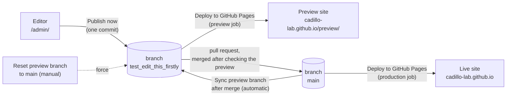
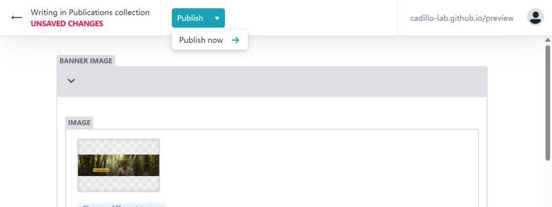
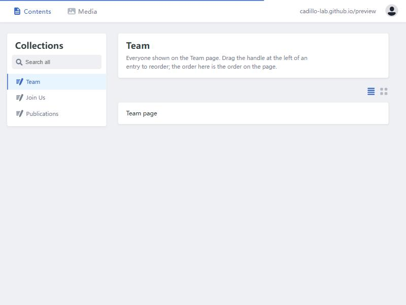
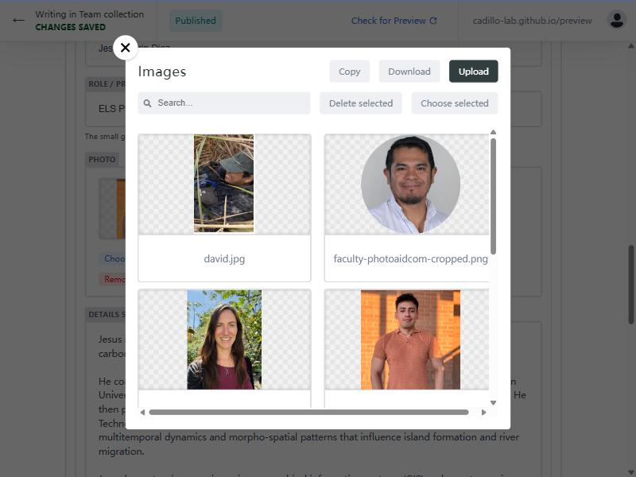
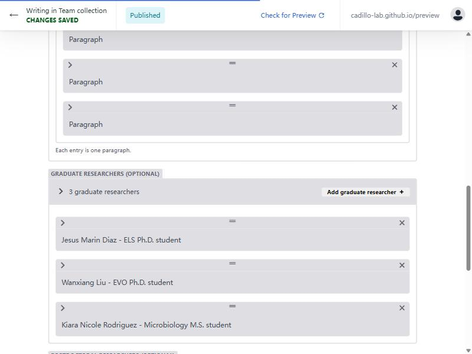
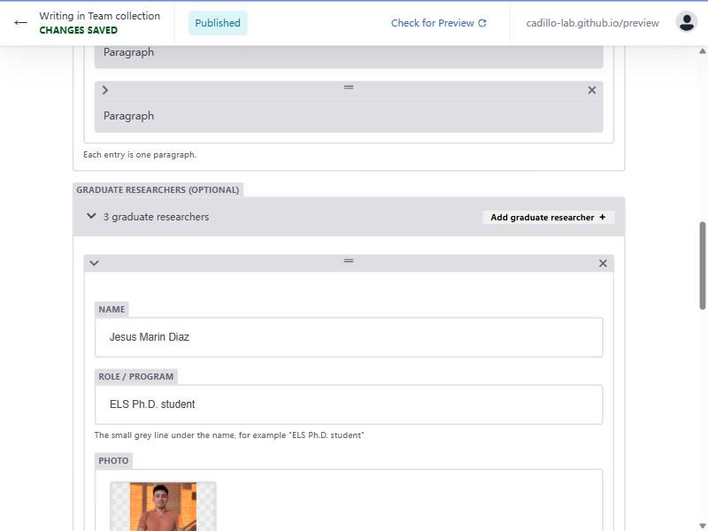
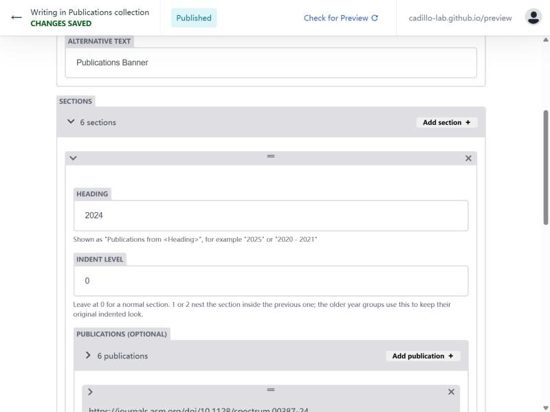

# Cadillo Lab website: content maintenance guide

内容维护指南。English first; each section ends with a short **中文要点** block.

This guide is for two roles:

- **Editors**: lab members who change the Team, Join Us and Publications pages in the
  browser, check the preview site, and put it on the live site with a few clicks on
  GitHub. No coding, no software to install.
- **The maintainer**: the person who manages accounts, helps when something goes wrong,
  and calls a developer when a page outside the editor must change.

| What | Where |
| --- | --- |
| Live site | <https://cadillo-lab.github.io/> |
| Preview site (edits appear here first) | <https://cadillo-lab.github.io/preview/> |
| Content editor | <https://cadillo-lab.github.io/admin/> |
| Source code and content | <https://github.com/Cadillo-Lab/cadillo-lab.github.io> |
| Build and publish runs ("Actions") | <https://github.com/Cadillo-Lab/cadillo-lab.github.io/actions> |
| Open a pull request (preview -> live) | <https://github.com/Cadillo-Lab/cadillo-lab.github.io/compare/main...test_edit_this_firstly?expand=1> |
| Login proxy (maintainer only) | `cms-oauth/README.md`, Worker `cms-auth` at <https://cms-auth.cadillo-lab.workers.dev> |

## Start here

**Editors** (you change text and pictures and put them on the live site): read this
section, then sections 2 to 7. Section 10 helps when something does not work. Sections 1,
8 and 9 are for the maintainer; you can skip them.

**Maintainer** (you manage accounts and help when something goes wrong): read everything.

### First time only: get access (about 10 minutes)

1. Get a free GitHub account, if you do not have one.
   1. Go to <https://github.com/signup>.
   2. Any e-mail works. Choose a user name you are happy to show the lab, for example
      `maria-lopez`.
   3. Confirm the e-mail that GitHub sends you.
2. Send your GitHub user name to the maintainer.
3. The maintainer adds you to the website repository (section 8.1). GitHub then e-mails
   you an invitation.
   1. Open the e-mail and click **View invitation**.
   2. Click **Accept invitation**.
4. Done. From now on you log in as in the next list.

### Every time: change something and publish (about 5 minutes)

1. Log in.
   1. Open <https://cadillo-lab.github.io/admin/>.
   2. Click **Login with GitHub**.
   3. A small window shows GitHub. The first time it asks you to authorize
      "Cadillo Lab website editor": click **Authorize**. The window closes by itself and
      the editor appears.
   4. If no small window appears, the browser blocked it: look for a "pop-up blocked"
      icon at the right end of the address bar, allow pop-ups for this site, and click
      **Login with GitHub** again.
2. Open the page you want to change.
   1. In the left column click **Team**, **Join Us** or **Publications**.
   2. Click the entry shown in the middle (for example **Team page**). The whole page
      opens as a form on the left; the right half shows a live preview of the page that
      changes as you type.
3. Make the change.
   1. Scroll to the list you need, for example **Graduate researchers**. Blocks that
      rarely change (the professor at the top of the Team page, the banner images)
      start closed: click the small arrow at their left to open them.
   2. To change an existing person or paper: click the small arrow at the left of its
      row to open it, then edit the text in the boxes. To change a photo, click
      **Choose different image**.
   3. To add one: click the **Add …** button at the top right of the list. A paper is
      quickest with its DOI. Sections 5 and 6 go through adding a person and a paper
      field by field.
   4. To remove one: click the **x** at the top right of its row.
   5. To change the order: drag the **=** handle at the top of a row.
   6. Glance at the preview on the right. A red message under a field means something
      is missing or in the wrong format; the message says what to change.
4. Publish.
   1. Click **Publish** at the top, then **Publish now**.
   2. The label at the top left changes from "UNSAVED CHANGES" to "CHANGES SAVED".
      Until that happens nothing is stored; closing the tab loses the change.
5. Check the preview site.
   1. Wait 2 to 4 minutes.
   2. Open <https://cadillo-lab.github.io/preview/> and go to the page you changed. If
      it still looks old, reload with Ctrl+F5 (Windows) or Cmd+Shift+R (Mac).
   3. Not right? Go back to the editor, fix it, publish again. Publish as often as you
      like: the live site is not affected.
6. Put the preview on the live site. When the whole preview site looks right, open a
   pull request and merge it (section 2.2, about 3 minutes). The live site updates a few
   minutes after that. If something went wrong, section 2.3 shows how to undo it.

**中文要点**

- 第一次：在 github.com/signup 注册账号 → 把用户名发给维护者 → 打开邀请邮件点 Accept invitation。
- 每次：打开 /admin/ 点 Login with GitHub（弹窗被拦截就在地址栏右侧允许弹窗）→ 左栏选页面、点中间的条目（左边是表单，右边是随输入变化的实时预览）→ 点行首箭头展开修改，或 Add 新增、x 删除、拖 = 排序；论文可直接粘贴 DOI 添加（第 6 节）→ 看一眼右侧预览，红字提示要先改好 → **Publish → Publish now**，左上角变成 CHANGES SAVED 才算保存 → 2–4 分钟后看 /preview/（不更新就 Ctrl+F5）→ 整个预览都没问题后，开 pull request 并合并（第 2.2 节）上线。
- 预览站可以反复改、反复发布；线上站只有 pull request 合并后才会变。出了问题看第 2.3 节如何撤销。

## 1. How the site is published



- The website is a React application. Its text and images for the Team, Join Us and
  Publications pages live in plain data files under `src/content/` and `public/images/`.
  The editor changes only those files.
- Every **Publish now** in the editor becomes one commit on the branch
  `test_edit_this_firstly`. A GitHub Actions workflow called **Deploy to GitHub Pages**
  then builds the site and publishes it under <https://cadillo-lab.github.io/preview/>.
  This usually takes 2 to 4 minutes. Nothing on the live site changes.
- The live site is built from the branch `main`. Content reaches `main` only when
  someone merges a pull request from `test_edit_this_firstly` (section 2.2). The same workflow then
  publishes the live site, and a second workflow, **Sync preview branch after merge**,
  moves the editing branch forward so that preview and live are identical again.
- Both sites are files on the branch `gh-pages`. Nobody edits that branch by hand.

**中文要点**

- 编辑器里的每次 Publish 都是对分支 `test_edit_this_firstly` 的一次提交，几分钟后出现在预览站 `/preview/`，线上站不受影响。
- 线上站来自分支 `main`。只有把预览分支的 pull request 合并进 `main`（第 2.2 节），内容才上线；合并后预览分支会自动对齐。
- `gh-pages` 分支是构建产物，不要手工改。

## 2. Publish, go live, undo

### 2.1 Publish (to the preview site)

In the editor, after changing something, click **Publish** and then **Publish now**. The
header changes from "Unsaved changes" to "Changes saved".

 Wait a few minutes and check the
preview site. Nothing goes live by itself: the live site changes only with section 2.2.

### 2.2 Go live: open and merge a pull request

Do this when the **whole** preview site looks right. Everything on the preview goes live
together, including edits that other people published there, so check with them if
several people are editing.

1. Open <https://github.com/Cadillo-Lab/cadillo-lab.github.io/compare/main...test_edit_this_firstly?expand=1>.
   The bar at the top must read **base: main** ← **compare: test_edit_this_firstly**; do
   not change it. Below, GitHub lists every change since the last time the site went
   live, file by file (data files and pictures).
   - "There isn't anything to compare": there is nothing new; you are done.
   - A green **View pull request** button instead of a form: a pull request is already
     open. Click the button and continue with step 3. (New publishes join an open pull
     request automatically until it is merged.)
2. Type a short title, for example "Add Jane Doe to the Team page", and click
   **Create pull request**.
3. Wait 1 to 2 minutes until the box near the bottom says **All checks have passed**.
   - Several checks are listed as **Skipped**. That is normal: the workflow has separate
     parts for the preview, the live site and the pull request, and each run uses only
     the part it needs.
   - **Build check (pull request)** is the check that matters: it builds the whole site
     from the preview.
   - If a check has a red ✗ ("Some checks were not successful"), do **not** merge. Fix
     the last edit in the editor or undo it (section 2.3), or ask the maintainer.
4. Click **Merge pull request**, then **Confirm merge**. The label turns purple:
   **Merged**. (Any merge method works; the default is fine.)
5. After 3 to 5 minutes check <https://cadillo-lab.github.io/> (Ctrl+F5 / Cmd+Shift+R if it
   looks old). Behind the scenes, **Deploy to GitHub Pages** has published the live site,
   and **Sync preview branch after merge** has brought the preview back in line with it.
   Nothing else to do.

### 2.3 Undo

| Situation | What to do |
| --- | --- |
| A mistake on the preview, not merged yet | Fix it in the editor and **Publish now** again. |
| Throw away **all** preview edits that are not live yet (make the preview a copy of the live site again) | Reset the preview, below. |
| The mistake is already on the live site | Revert the pull request, below. |

**Reset the preview** (overwrite the preview with the live site):

1. Tell the other editors first: their unmerged edits will be lost too.
2. Open the [Actions tab](https://github.com/Cadillo-Lab/cadillo-lab.github.io/actions),
   click **Reset preview branch to main** in the left column, then **Run workflow**, keep
   "Branch: main", and click the green **Run workflow** button.
3. After 3 to 4 minutes the preview equals the live site. Everything that was only on the
   preview is gone, including pictures uploaded for it. The live site is untouched.
4. If a pull request was open, it now shows no changes: open it and click
   **Close pull request**.

**Revert a pull request** (take a change back off the live site):

1. Open the [closed pull requests](https://github.com/Cadillo-Lab/cadillo-lab.github.io/pulls?q=is%3Apr+is%3Aclosed)
   and click the one that brought the mistake.
2. Click **Revert** near the bottom. GitHub opens a new pull request that undoes it; click
   **Create pull request**.
3. Wait for **All checks have passed**, then click **Merge pull request** and
   **Confirm merge**.
4. A few minutes later the live site and the preview are both back to how they were
   before that pull request. Then make the correct edit in the editor and go live again
   (sections 2.1 and 2.2).

**中文要点**

- 发布到预览：改完点 **Publish → Publish now**，几分钟后看预览站。
- 上线：确认整个预览站都没问题（别人发布到预览的改动也会一起上线）→ 打开上面的 compare 链接，顶部应为 base: main ← compare: test_edit_this_firstly → **Create pull request** → 等 **All checks have passed**（几项 Skipped 是正常的，关键是 Build check；有红叉不要合并）→ **Merge pull request → Confirm merge** → 3–5 分钟后看线上站，预览会自动对齐。已有打开的 PR 时点 View pull request 进去直接合并。
- 撤销：预览上的错误直接在编辑器里再改；想丢弃所有未上线的修改，用 Actions → **Reset preview branch to main** → Run workflow（先通知其他编辑，之后关闭空的 PR）；错误已经上线，就在已关闭的 PR 列表里打开那个 PR，点 **Revert** → Create pull request → 检查通过后合并。

## 3. Logging in to the editor

1. Open <https://cadillo-lab.github.io/admin/> and click **Login with GitHub**.
2. A popup shows GitHub. The first time, GitHub asks you to authorize "Cadillo Lab
   website editor"; click **Authorize**. The popup closes and the three collections
   (Team, Join Us, Publications) appear.
3. If the popup says "Your GitHub user account does not have access to this repo", your
   GitHub account is not yet a collaborator. Ask the maintainer (section 8.1).

You need a free GitHub account. The editor never sees your GitHub password; GitHub only
hands it a limited access token for public repositories.

**中文要点**

- 用 GitHub 账号登录，第一次需要点 Authorize。提示没有权限时，请维护者把你加为仓库协作者（Write 权限）。

## 4. Editor basics



- **Collections** in the left column are the three editable pages. Each one opens a single
  entry ("Team page", "Publications page", ...) that holds the whole page.
- **Live preview:** an open entry shows the form on the left and, on the right, roughly
  how the page will look. The preview follows every keystroke; on the Team page, hovering
  over a photo shows the text visitors see. The eye button at the top right of the
  preview hides or shows it. The preview is a close imitation, not the site itself: after
  publishing, the preview site still shows the real result.
- Most content is a **list**: a numbered row per person, position, photo or paper. Rows
  are collapsed to one line; click the small arrow at the left of a row to open it.
  Blocks that rarely change (Faculty on the Team page, the banner images) also start
  closed and show a one-line summary.
- **Add** buttons sit at the top right of every list ("Add graduate researcher",
  "Add publication", ...). New rows appear at the bottom of the list. Papers can also be
  added from their DOI (section 6).
- **Reorder** by dragging the handle (the "=" symbol) at the top of a row. The order in the
  editor is the order on the page, except for the lists marked "grouped by year", which
  the site sorts by itself.
- **Delete** a row with the "x" at its top right.
- **Images**: click **Choose an image** (or **Choose different image**). A window shows the
  images already used by that part of the site; click **Upload** to add a new one from
  your computer, then **Choose selected**. Give files short names without spaces before
  uploading, for example `maria-lopez.jpg` or `2026-nature-microbiology.png`.
  
- **Picture size:** under every picture the editor shows its size, for example
  "This picture: 1000 × 1000 px, 1.6 MB", and the recommended size for that spot (the
  table below). A yellow note explains what is off: the file is heavy and makes the page
  slow, the photo is not square, or it is too small. It is advice only; publishing still
  works.
- A picture that is not on the live site yet (you just uploaded it, or it is only on the
  preview site) shows the note "This picture is not on the live site yet". That is
  expected: it goes live with the next merged pull request (section 2.2).
- The grey text under a field is a hint about how the site uses it.
- **Checks:** some fields are checked as soon as you leave them. A red message names the
  problem, for example a DOI pasted as a full `https://doi.org/...` address (enter only
  the `10.xxxx/...` part), a link that does not start with `https://`, or a required field
  left empty. Publishing waits until the red messages are fixed. The outreach photos and
  the publication sections must keep at least one row.
- Leaving the page with unsaved changes shows a browser warning; nothing is stored until
  you click **Publish now**.

Image sizes that fit the current design (the editor shows the same recommendation under
each picture):

| Image | Shown as | Upload |
| --- | --- | --- |
| Team member photo | circle, about 240 px | square photo, 500 to 1000 px on each side, JPG or PNG, under 500 KB |
| Faculty photo | 280 x 280 px | square, as above |
| Publication thumbnail | about a third of the page width, enlarges on hover | portrait, about 850 x 1100 px (the existing ones), PNG or JPG, under 500 KB |
| Publications banner | full width, at most 400 px tall | landscape, about 1900 x 500 px, under 1 MB |
| Join Us banner | full width, about 3:1 | landscape, about 2900 x 1000 px, under 1 MB |
| Outreach carousel photo | full width, 500 px tall, cropped to fit | landscape, about 1500 x 1000 px, under 800 KB |

Large photos work, but they slow the page down for visitors; several current photos are
over 1 MB and could be re-saved smaller at any time.

**中文要点**

- 左栏三个集合对应三个页面；打开条目后左边是表单，右边是实时预览（随输入变化；团队页可把鼠标移到头像上看简介；预览右上角的眼睛按钮可隐藏）。预览只是近似效果，发布后仍以预览站为准。
- 内容多为列表，点行首箭头展开，右上角 Add 新增，拖动行顶的 "=" 调整顺序，右上角 x 删除。教授信息和横幅图默认折叠，点箭头展开。
- 图片点 Choose an image → Upload 上传，文件名用短的英文和连字符，不带空格。每张图下面显示像素尺寸、文件大小和建议尺寸；黄色提示表示太大、不是方形或太小，只是建议，不影响发布。刚上传或只在预览站上的图片会注明 "not on the live site yet"，属正常现象。
- 红字表示格式不对或必填项为空（例如 DOI 只填 10.xxxx/... 部分，链接要以 https:// 开头），改好才能发布。只有点了 Publish now 才会保存。

## 5. Step by step: add a team member



1. Collections -> **Team** -> **Team page**.
2. Scroll to the list for the right group: **Graduate researchers**, **Postdoctoral
   researchers** or **Undergraduate researchers**.
3. Click **Add graduate researcher** (or the matching button). A new row opens at the
   bottom of the list.
4. Fill in:
   - **Name**: as it should appear under the photo.
   - **Role / program**: the small grey line, for example `ELS Ph.D. student`.
   - **Photo**: Choose an image -> Upload -> pick the file -> Choose selected. A square
     photo works best because the page cuts it to a circle; the size line under the
     photo shows whether it fits (section 4).
   - **Details shown on hover** (graduate and postdoctoral researchers only): the text
     that appears in the grey box when a visitor hovers over the photo. An empty line
     starts a new paragraph.
   - **Bio** can stay empty; the page does not show it at the moment.
5. Drag the row to the right place in the list; the page shows people in this order.
6. Check the preview on the right: the new person appears with photo, name and role, and
   hovering over the photo shows the hover text.
7. **Publish -> Publish now**. Check <https://cadillo-lab.github.io/preview/team> after a
   few minutes.



**When someone leaves:** open their row, note the details, delete the row with the "x", then
add them under **Alumni** in the matching list (for example **Graduate alumni** with
**Name** and **Details** such as `Ph.D. student in Microbiology (2021-2026)`). The alumni
lists marked "grouped by year" (honors theses, high school researchers, international
scholars) sort themselves by year; the others keep the order you give them. The last row
of **Postdoctoral alumni**, with a blank name and blank details, is intentional spacing;
leave it where it is.

**中文要点**

- Team → Team page → 找到对应列表 → Add … → 填 Name、Role、Photo（上传，方形最好，照片下方会显示尺寸是否合适）、悬停详情 → 拖到正确位置 → 看右侧预览确认 → Publish now → 几分钟后看预览站 /preview/team。
- 成员离开：删除该行，在 Alumni 对应列表里新增一行（姓名 + 说明）。Postdoctoral alumni 最后一行空白是刻意的间距，请保留。

## 6. Step by step: add a paper



1. Collections -> **Publications** -> **Publications page**.
2. Under **Sections**, open the section for the year (click the arrow at the left of its
   row, for example `2026`). If the year does not exist yet, see "A new year" below.
3. In the blue bar **Add a paper from its DOI** of that section, paste the paper's DOI and
   click **Add paper**. Any of these forms works: `10.1128/spectrum.00387-24`,
   `doi:10.1128/spectrum.00387-24`, `https://doi.org/10.1128/spectrum.00387-24`.
   - The editor looks the paper up and adds a row at the bottom of the section with
     **Title**, **Authors**, **Journal**, **Year**, **DOI** and **Link** already filled in.
     It asks Crossref, and doi.org for DOIs that Crossref does not know (for example
     ResearchGate DOIs, which start with `10.13140`).
   - If the DOI is already listed on the page (also inside a journal link), it asks before
     adding it again.
   - If it reports that no record was found or that the service could not be reached,
     click **Add publication** instead and fill in the fields yourself (next step).
4. Open the new row (the arrow at its left) and complete it:
   - **Thumbnail** (required): the picture visitors click. Most existing ones are the first
     page or a key figure of the paper, portrait, about 850 x 1100 px.
   - **Link (URL)**: where the thumbnail leads. The DOI lookup fills in the DOI address;
     change it to the journal page if you prefer. It must start with `https://`.
   - **Title**: used as the alternative text of the thumbnail (read by screen readers
     and shown if the image fails to load). Please fill it in for new papers.
   - **Authors**, **Journal**, **Year**, **DOI**: records for the lab's own bookkeeping;
     the page does not display them. If **Link** is empty, the DOI is used to build the
     link. Enter the DOI without `https://doi.org/`.
5. Drag the row to where it should appear within the section (first row = first on the
   page); the preview on the right shows the thumbnails in that order. Then
   **Publish -> Publish now** and check <https://cadillo-lab.github.io/preview/publications>.

**A new year:** click **Add section** at the top of the Sections list, set **Heading** to
the year (the page shows it as "Publications from 2026"), leave **Indent level** at
"0 - normal section", then drag the new section to the top of the list so the newest year
comes first. Add papers to it as above.

**About "Indent level":** the page shows the older groups "2020 - 2021" and "2011 - 2015"
indented under the section above them, a leftover of how the page was first written.
Their Indent level values (1 and 2) keep that look exactly as it was. New sections use
"0 - normal section". Do not change the value on existing sections unless you want the
layout to change.

**中文要点**

- Publications → Publications page → 展开对应年份的 section → 在蓝色栏 "Add a paper from its DOI" 粘贴 DOI → 点 Add paper，自动在该年份末尾新增一行，并填好标题、作者、期刊、年份、DOI 和链接 → 展开新行上传缩略图（竖版约 850×1100，必填）→ 拖到合适位置 → Publish now。
- 查不到 DOI 或网络不通时，改用 Add publication 手动填写；DOI 只填 10.xxxx/... 部分，链接以 https:// 开头。
- 新年份：Sections 顶部 Add section → Heading 填年份 → Indent level 保持 "0 - normal section" → 拖到最上面。
- Indent level 只是为了保留旧年份组原有的缩进外观，已有 section 不要改动。

## 7. The other editable parts

| Where in the editor | What it changes on the site |
| --- | --- |
| Team -> Team page -> **Faculty** | The professor's name, title, contact line, photo, education lines and biography paragraphs at the top of the Team page. |
| Team -> Team page -> **Alumni** | The six collapsible alumni lists at the bottom of the Team page. |
| Join Us -> **Open positions** | The "Open Position" / "Position" drop-downs in the three sections of the Join Us page. An empty list shows "No positions available". A position has a title and a description; the description is shown as one block of text. |
| Join Us -> **Graduate program links** | The comma-separated list of program links after "Professor Cadillo is a faculty member in the following programs:". |
| Join Us -> **Banner and outreach photos** | The banner image at the top of Join Us and the rotating outreach photos at the bottom (they rotate in the order of the list; keep at least one). |
| Publications -> Publications page -> **Banner image** | The banner at the top of the Publications page. |

**Not editable in the editor:** the Home, Research, Collaborations and Mission Statement
pages, the navigation bar, the footer, colours and layout. Those are part of the code and
need a developer (section 9).

**中文要点**

- 教授信息、校友列表、招聘职位、项目链接、Join Us 横幅与轮播图、Publications 横幅都在编辑器里；首页、Research、Collaborations、Mission Statement、导航、页脚和样式需要开发者改代码。

## 8. For the maintainer: accounts, access and handover

### 8.1 Giving someone editing rights

Repository -> **Settings** -> **Collaborators and teams** -> **Add people** -> enter their
GitHub user name -> role **Write**. They accept the invitation by e-mail, then they can log
in to the editor. Remove people the same way when they leave the lab. **Write** also
lets them merge pull requests, revert them and run the reset workflow (sections 2.2 and
2.3), which is how editors put their changes on the live site. Point new editors to the
README or to "Start here" above.

### 8.2 Who owns what

| Thing | Where it lives | Who must have access |
| --- | --- | --- |
| Source code, content, images, workflows | GitHub repository `Cadillo-Lab/cadillo-lab.github.io` | The maintainer as organization owner or repository admin; editors with Write. |
| Published site (live and preview) | GitHub Pages, branch `gh-pages` | Automatic; nobody edits it. |
| Login proxy `cms-auth` | A Cloudflare account (Workers, free plan) | The maintainer; add a second member under Cloudflare -> Manage Account -> Members. |
| GitHub OAuth App "Cadillo Lab website editor" | GitHub, ideally owned by the Cadillo-Lab organization | Organization owners. |
| Editor software (Decap CMS) and the lab's additions | Decap from a public CDN, version pinned in `public/admin/index.html`; live previews, DOI lookup and picture notes in `public/admin/cms-extensions.js` (section 9.1) | No account. The DOI lookup uses the public Crossref and doi.org services, without a key. |

Record here who holds the Cloudflare account and when the OAuth App was created:

- Cloudflare account e-mail: wliu176@asu.edu (Wanxiang Liu; Workers subdomain cadillo-lab.workers.dev)
- OAuth App created on: 2026-11-05, owned by: GitHub user Johnxiaoming (Wanxiang Liu). Note: Cadillo-Lab is a personal GitHub account, not an organization; transfer the OAuth App to it at handover.

### 8.3 Handover checklist

When the maintainer changes:

1. GitHub: make the successor an owner of the Cadillo-Lab organization (or at least an
   admin of the repository).
2. Cloudflare: invite the successor as a member of the account that hosts `cms-auth`,
   or let them redeploy the Worker from `cms-oauth/` under their own account and update
   both the OAuth App's callback URL and `base_url` in `public/admin/config.yml`
   (`cms-oauth/README.md`, steps 1 to 4).
3. GitHub OAuth App: if it is owned by a person, transfer it to the organization
   (OAuth App page -> **Transfer ownership**). Generate a new client secret and store it
   with `npx wrangler@4 secret put GITHUB_CLIENT_SECRET`; delete the old one.
4. Update the two lines in 8.2 and the maintainer's name wherever it is written.

### 8.4 If something is lost

- **Cloudflare account gone:** deploy `cms-oauth/` again under any Cloudflare account,
  create a new OAuth App, set the secrets, update `base_url`. About one hour of work; the
  website keeps running meanwhile, only editor logins stop.
- **The editor no longer loads:** the CDN file is pinned to one version with an
  integrity hash in `public/admin/index.html`; the comment there explains how to change
  the version and recompute the hash. Until fixed, content can still be changed by editing
  the JSON files on GitHub directly. If the editor loads but a field shows an error such
  as "No control for widget", `public/admin/cms-extensions.js` did not load: `config.yml`
  relies on it for the publications lists and the pictures.
- **A workflow fails:** open the red run in the Actions tab; the failing step shows the
  error. The most common causes are a broken image path in a JSON file (fix it in the
  editor or on GitHub) and GitHub-side outages (just rerun the workflow with
  **Re-run jobs**).

### 8.5 Things to keep in mind

- Never publish to `gh-pages` from a computer. The old `npm run deploy` script has been
  removed from `package.json`; a manual push to `gh-pages` would replace the whole branch
  with a local build and delete the preview site.
- The editing branch name `test_edit_this_firstly` is written in five places:
  `.github/workflows/deploy.yml` (twice), `reset-preview.yml`, `sync-after-merge.yml` and
  `public/admin/config.yml`. Renaming the branch means changing all five.
- GitHub Pages is case-sensitive: `Photo.JPG` and `photo.jpg` are different files. The
  editor's uploader avoids problems; renaming files by hand on GitHub can cause them.
- The preview and live sites each contain a copy of every image and of the large
  background video of the home page, so the `gh-pages` branch is a few hundred megabytes.
  That is normal.

**中文要点**

- 加编辑者：仓库 Settings → Collaborators and teams → Add people → Write。Write 权限也能合并、回退 PR 和重置预览，编辑者就是这样自己上线的（第 2.2、2.3 节）。
- 四样东西要有人管：GitHub 组织/仓库、Cloudflare 账号（cms-auth）、GitHub OAuth App（建议归组织所有）、编辑器版本（写在 index.html 里；实验室自己的预览、DOI 查询和图片提示在 cms-extensions.js）。
- 交接：继任者成为组织 owner → 加入 Cloudflare 账号或自行重新部署 → OAuth App 转给组织并换 secret → 更新本文 8.2。
- 绝不要从本地电脑往 `gh-pages` 发布（旧的 `npm run deploy` 脚本已删除）；分支名写在五处。

## 9. For developers

Local setup:

```bash
git clone https://github.com/Cadillo-Lab/cadillo-lab.github.io.git
```

```bash
npm ci
```

```bash
npm start
```

`npm start` serves the site at <http://localhost:3000>. To use the content editor against
your local files, run `npx decap-server` in a second terminal and open
<http://localhost:3000/admin/index.html> (the development server needs the full file
name; on the published site plain `/admin/` works). "Login" then works without GitHub and
writes directly into `src/content/` and `public/images/` of your checkout.

- Build check: `CI=false npm run build` (the `CI=false` keeps ESLint warnings from failing
  the build, as in the workflows).
- Content files: `src/content/*.json` (one file per editable page or section, see
  `public/admin/config.yml` for the fields). Components read them with `import`.
- Images managed by the editor: `public/images/{team,joinus,publications}`; components
  prefix them with `process.env.PUBLIC_URL` so they work at `/` and at `/preview/`.
  Images bundled by webpack (Home, Research, Collaborations) stay in `src/assets/`.
- Routing: `BrowserRouter` gets `basename={process.env.PUBLIC_URL}`, and `public/404.html`
  keeps the `preview` path segment, which is what makes deep links work under `/preview/`.
- Workflows: `deploy.yml` (production, preview, pull-request check), `sync-after-merge.yml`,
  `reset-preview.yml`; all comments are in the files. Node 22, `npm ci`.
- Code changes follow the same path as content: push to `test_edit_this_firstly`, look at
  the preview, open a pull request, merge.

### 9.1 What is in `public/admin/`

| File | Purpose |
| --- | --- |
| `index.html` | Loads Decap CMS (pinned version + integrity hash), then `cms-extensions.js` and `admin.css`. The comment there explains how to upgrade. |
| `config.yml` | Collections and fields. Uses two lab widgets: `publication_list` (a list with the DOI bar) and `lab_image` (an image field with the size line; the recommendation is the `recommended:` setting of each picture field). |
| `cms-extensions.js` | Live previews of the five entries (`CMS.registerPreviewTemplate`), the DOI bar, the size notes, and the fallback that shows pictures not on the live site yet. Plain browser JavaScript without a build step; comments explain each part. |
| `preview.css` | Look of the preview pane, a simplified copy of the site's styles. The site does not use it. |
| `admin.css` | Login page and small adjustments of the editor itself, plus the DOI bar and size notes. |
| `lab-logo.png` | Logo on the login page and in the editor header. |

Every reference is a relative path, so the same folder works at `/admin/` and
`/preview/admin/`. The website code under `src/` does not depend on any of these files.

Some parts rely on Decap internals that are not a public API; that is one more reason
the Decap version is pinned:

- The DOI bar and the size notes wrap Decap's own list and image widgets
  (`CMS.getWidget('list')`, `CMS.getWidget('image')`); the DOI bar adds its row through the
  list widget's `addItem` method.
- `admin.css` matches Decap's components by name, for example `[class*="-LoginButton"]`.
  Decap generates class names such as `css-39fnji-LoginButton`; the hash part changes
  whenever Decap's styles change, the name part only when a component is renamed.
- Decap shows a picture path such as `/images/team/x.jpg` straight from the site root, so
  a picture that is not on the live site yet would stay a broken thumbnail.
  `cms-extensions.js` tries the copy in memory (fresh upload), then the live site, then
  the preview site (`display_url` in `config.yml`).

After upgrading Decap, check in the editor: the preview of every entry; adding a paper
from a DOI; uploading a picture (its size line and its preview); the login page. A
renamed component only loses its styling; a missing `addItem` makes the DOI bar say so,
and "Add publication" keeps working.

With `npx decap-server`, **Publish** writes into the checkout it runs in (`src/content/`
and `public/images/`). Test saving in a copy of the repository or revert afterwards with
`git checkout`. The DOI lookup calls `api.crossref.org` and `doi.org` from the browser.

### 9.2 Switching from Decap CMS to Sveltia CMS

[Sveltia CMS](https://github.com/sveltia/sveltia-cms) is a modern rewrite of Decap that
reads the same `config.yml`. It was evaluated in November 2026 (version 0.262.1, by reading
its published code) and not adopted, because the lab's additions above depend on Decap.
What was found:

- **Login:** compatible. Sveltia opens `base_url/auth?provider=github&site_id=...&scope=...`
  and exchanges the same `authorizing:github` / `authorization:github:success:...` messages
  as the `cms-auth` Worker, and it passes on `auth_scope: public_repo`. Its login page also
  offers "Sign In Using Access Token" unless `backend.auth_methods: [oauth]` is set.
- **Content:** file collections, nested lists and objects, per-field media folders,
  `summary`, `commit_messages` and `display_url` are supported.
- **Local testing:** `local_backend` is ignored and `decap-server` is not supported. Local
  editing uses "Work with Local Repository" in Chrome or Edge, which reads the folder
  directly.
- **Loading:** the main script can carry an integrity hash, but Sveltia loads further
  code (React, some libraries) and its font from unpkg and jsDelivr at run time, pinned by
  version but without hashes.
- **Gains:** a newer interface, a media library with search and drag and drop, full-text
  search, dark mode, a Chinese interface for browsers set to Chinese, built-in image
  resizing on upload.
- **What would have to change:** the preview templates can stay (Sveltia supports
  `registerPreviewTemplate` with `h` and `createClass`). `publication_list` and
  `lab_image` wrap Decap's built-in widgets, which Sveltia does not provide in the same
  form: set those fields back to `widget: list` and `widget: image` (losing the DOI bar
  and the size notes until they are rewritten), then replace the Decap `<script>` tag with
  a pinned `https://unpkg.com/@sveltia/cms@<version>/dist/sveltia-cms.js`. Try it on the
  preview site first; to go back, restore the Decap script tag and the two widget names.

**中文要点**

- 本地开发：`npm ci`、`npm start`；本地编辑器需另开终端运行 `npx decap-server`，并访问 `http://localhost:3000/admin/index.html`。在本地点 Publish 会直接改写当前目录里的文件，测试保存请用副本。
- 内容在 `src/content/*.json` 与 `public/images/`；代码改动也走预览分支 → PR → 合并。
- 后台文件都在 `public/admin/`：`cms-extensions.js`（实时预览、DOI 查询、图片尺寸提示、未上线图片的显示）、`preview.css`、`admin.css`、`lab-logo.png`，全部用相对路径。部分功能依赖 Decap 内部实现，升级 Decap 后要逐项复查预览、DOI 添加、图片上传和登录页。
- Sveltia：登录协议兼容，但不支持 decap-server；DOI 栏和图片提示依赖 Decap 内置控件，切换前要把这两个字段改回 `list` / `image`。

## 10. Troubleshooting

| Symptom | What to do |
| --- | --- |
| Published, but the preview site has not changed after 10 minutes | Actions tab -> the newest **Deploy to GitHub Pages** run. Still running: wait. Red: open it and read the failing step (section 8.4). Green: reload the page with Ctrl+F5 / Cmd+Shift+R; the browser was showing an old copy. |
| An image shows as a broken icon | Open the row in the editor and choose the image again; the stored path must start with `/images/`. If you renamed a file on GitHub, the name in the data must match exactly, including capitals. Under the picture, "This picture could not be found" confirms that the file name does not match any file. |
| Under a picture: "This picture is not on the live site yet" | Normal for a picture you just uploaded or that so far exists only on the preview site. It goes live with the next merge (section 2.2). |
| A yellow note under a picture | Advice only; publishing works. To follow it, save a smaller copy of the picture (for example 1000 px wide, as JPG, with any photo editor) and upload that instead. |
| "Add paper" says no record was found | Check the DOI for typos; only the `10.xxxx/...` part is needed. Some DOIs are registered neither with Crossref nor with doi.org's other agencies: click **Add publication** and fill in the fields by hand. |
| "Add paper" says the DOI service could not be reached | The internet connection or Crossref is down for a moment. Try again later, or add the paper by hand with **Add publication**. |
| "Unsaved changes" but Publish is greyed out | A required field is empty; the editor marks it in red. Fill it in or delete the row. |
| An entry opens empty ("0 sections", blank fields) although the page has content | The editor failed to load the file. This happens when you switch from one open entry straight to another by changing the address in the browser bar. Reload the browser page (F5) and open entries from the collection list. Publishing such an empty form is refused, so the page cannot be wiped by accident, but anything typed into it is lost: reload first. |
| Login popup opens and closes, nothing happens | See the troubleshooting table in `cms-oauth/README.md`. |
| The live site did not update after merging | Actions tab -> the **Deploy to GitHub Pages** run for `main`. If it was cancelled (rare, when several runs queue up), click **Re-run jobs**, or Actions -> Deploy to GitHub Pages -> **Run workflow** on `main`. |
| Preview and live differ after a merge even though nothing new was published | Wait for **Sync preview branch after merge** and the preview build it starts (a few minutes). If the sync says the preview branch has edits that are not on main, those are unpublished edits; open a pull request for them or reset the preview. |

**中文要点**

- 预览没更新：先看 Actions 里最新一次 Deploy 运行；绿色就强制刷新浏览器。图片不显示：在编辑器里重新选择该图片。Publish 灰色：有必填项为空。登录问题看 `cms-oauth/README.md`。
- 图片下方 "not on the live site yet" 是正常现象；黄色提示只是建议；"could not be found" 表示路径对不上，需要重新选择图片。
- Add paper 查不到或连不上：检查 DOI（只要 10.xxxx/... 部分），或改用 Add publication 手动填写。
- 条目打开是空白的：通常是在地址栏直接从一个条目跳到另一个条目造成的；按 F5 刷新后从集合列表重新打开，不要在空白表单里重新填写。
